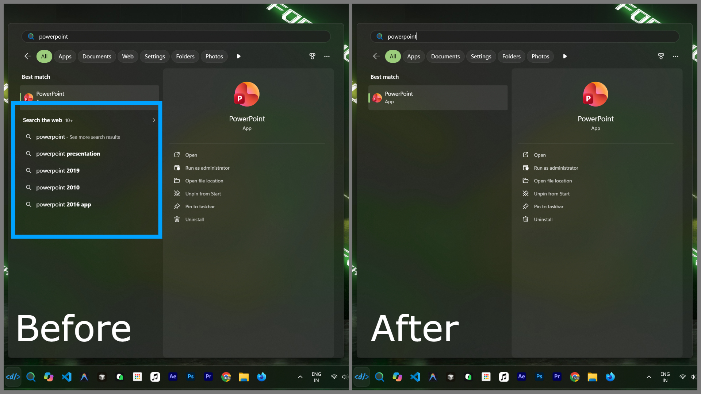

# Disable Web Search in Start Menu

Keeps the Start menu and taskbar search local. Web results, Bing suggestions and
the "search the web" row stop showing up, and local results keep working.

Windows already has settings and policies for this, but they are read when the
search UI starts, so applying them means signing out, and the registry entries
stay behind afterwards. This mod answers those reads from inside the search UI
process instead: nothing is written to the registry, and turning the mod off
restores the default behavior the next time the search UI starts.

## Settings

| Setting | Default | What it does |
| --- | --- | --- |
| Also hide cloud content results (OneDrive, Outlook, SharePoint) | on | Reports the two "Cloud content search" switches from Settings as off. The Windows 11 search UI asks for them before it puts web results in the list, so turning this off can bring web results back — and this setting also hides OneDrive, Outlook and SharePoint results. |

## Which process it hooks

`SearchHost.exe` (Windows 11) and `SearchApp.exe` (Windows 10). Those are the
search UI, and typing in the Start menu hands the query to it, so the Start menu
search is covered too. `StartMenuExperienceHost.exe` is not hooked: it draws the
Start menu itself and loads none of the search components.

The mod reports the same values Windows itself uses:

- `DisableSearchBoxSuggestions` in `Software\Policies\Microsoft\Windows\Explorer`
- `ConnectedSearchUseWeb`, `DisableWebSearch` and `AllowCloudSearch` in
  `Software\Policies\Microsoft\Windows\Windows Search`
- `BingSearchEnabled` in `Software\Microsoft\Windows\CurrentVersion\Search`
- `IsMSACloudSearchEnabled` and `IsAADCloudSearchEnabled` in
  `Software\Microsoft\Windows\CurrentVersion\SearchSettings`

Values you set yourself are left alone; the mod only fills in the answers the
search UI asks for, for both the current user and the machine.

Every registry function has two entry points in a process: one in
`advapi32.dll` for desktop callers, one in `kernelbase.dll` for the API sets that
packaged apps use. On current builds these are separate addresses, so both are
hooked; when a build only forwards, the second set is skipped.

## After enabling or changing a setting

Web results are decided while the search UI sets up. End `SearchHost.exe` in
Task Manager (Windows starts it again on the next search) or sign out, otherwise
the old behavior stays until the next restart.

## If web results still show up

Turn on the mod's log in Windhawk and open the search UI once. Every read the mod
answered is listed, which shows whether the process asks for these values at
all. If it does not, that build gates web results somewhere else, and the log is
the place to start.
